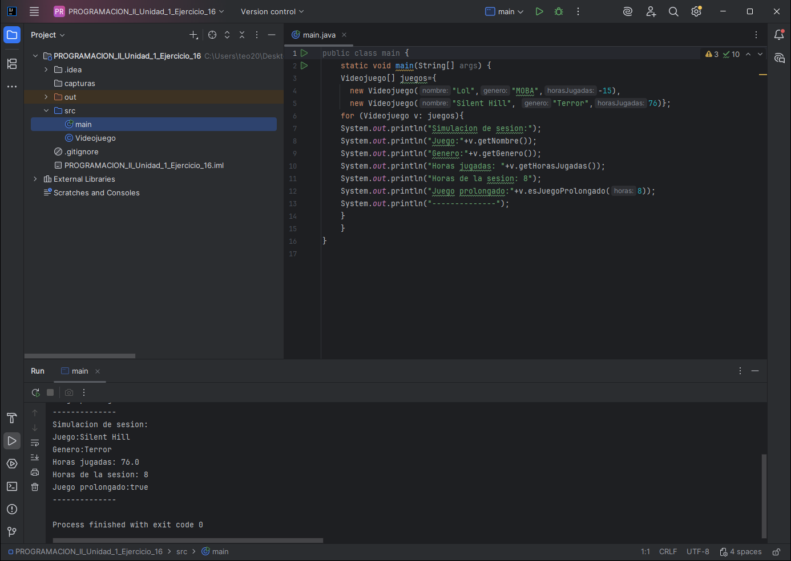

# PROGRAMACIÓN II — Unidad 1, Ejercicio 16: Catálogo de Videojuegos y Horas Jugadas

Trabajo práctico de Programación II. Este repositorio contiene la resolución en Java del ejercicio 16 de la Unidad 1.

## Consigna

#### Contexto

Las plataformas de distribución digital de videojuegos permiten a los usuarios registrar sus títulos favoritos y llevar un control detallado del tiempo invertido en cada uno.

#### Consigna

Diseñar una clase en Java que represente un videojuego dentro de la biblioteca de un usuario y permita registrar sus horas de juego acumuladas.

#### Desarrollo requerido

- Definir la clase Videojuego con atributos nombre (String), genero (String) y horasJugadas (double).
- Incorporar un constructor que inicialice los datos y asegure que las horas no comiencen con valores negativos.
- Implementar un método registrarSesion(double horas) para sumar tiempo de juego y un método esJuegoProlongado() que retorne true si las horas superan las 50.
- En el método main, instanciar dos videojuegos, simular sesiones de juego en ambos y mostrar por consola si califican como prolongados.

## Estructura del repositorio

```
PROGRAMACION_II_Unidad_1_Ejercicio_16/
├── README.md
├── capturas/
│   └── consola.png
└── src/
    ├── main.java   # clase con el método main
    └── Videojuego.java
```

## Funcionamiento y lógica

### `Videojuego`

Representa un videojuego de la biblioteca de un usuario con los atributos privados `nombre`, `genero` y `horasJugadas`.

- **Constructor:** guarda nombre y género. Las horas jugadas solo se aceptan si son positivas; si no, se cargan en **0** usando el operador ternario.
- **`registrarSesion(double horas)`:** suma las horas de una nueva sesión al total.
- **`esJuegoProlongado(double horas)`:** devuelve `true` si las horas jugadas acumuladas llegan a **50 o más**.
- **Getters:** devuelven nombre, género y horas jugadas.

### `main`

Crea un arreglo con dos juegos y lo recorre con un `for-each`, mostrando los datos de cada uno:

- **Lol** (MOBA) se crea con −15 horas, así que el constructor lo deja en 0 → no es un juego prolongado (`false`).
- **Silent Hill** (Terror) tiene 76 horas → es un juego prolongado (`true`).

## Ejecución

Captura de la consola de IntelliJ IDEA ejecutando el programa:



Salida obtenida:

```
Simulacion de sesion:
Juego:Lol
Genero:MOBA
Horas jugadas: 0.0
Horas de la sesion: 8
Juego prolongado:false
--------------
Simulacion de sesion:
Juego:Silent Hill
Genero:Terror
Horas jugadas: 76.0
Horas de la sesion: 8
Juego prolongado:true
--------------
```
